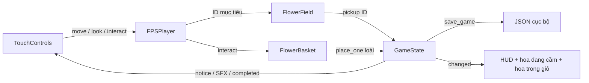

# Little Bloom — kiến trúc code hiện tại

Cập nhật: 21/11/2026 · Task T0.1 · Mốc code được đọc: `6fc071c`.

Bổ sung D0 ngày 21/11/2026: cập nhật chuyển động và spawn; [báo cáo kiểm thử](STAIRCASE_CHECK.md). Phần kiểm tra T0.1 cuối tài liệu vẫn là lịch sử của task tài liệu.

Tài liệu mô tả hiện trạng bằng cách đọc toàn bộ 10 script, 2 scene, cấu hình project/export và đối chiếu [PRODUCT_SPEC](../PRODUCT_SPEC.md). Không sửa gameplay, không chạy Godot hoặc đo trên Android trong task này. Các sơ đồ dưới đây được suy ra từ code, không phải ảnh chụp cây Remote khi chạy.

## 1. Tổng quan và ranh giới

Game hiện là prototype một cửa hàng hai tầng, **504 bông (56 mỗi loại), 9 giỏ, mang tối đa 5 bông**. Menu, phòng, UI và hình hoa được dựng chủ yếu bằng GDScript khi chạy. Hai file `.tscn` chỉ chứa node gốc và script; vì vậy cây scene trong Editor không chứa sẵn toàn bộ cửa hàng.

`GameState` giữ tiến độ bằng ID hoa. `main.gd` dựng thế giới, `FPSPlayer` điều khiển và chọn mục tiêu, `FlowerField` quản lý hoa ngoài giỏ, `FlowerBasket` gọi thao tác đặt. Hình ảnh chỉ biểu diễn dữ liệu; không có một physics body cho mỗi bông.

Demo 90 bông và giỏ mở đầu 10 bông trong [DEMO_PLAN](../DEMO_PLAN.md) **chưa triển khai**. Chưa có cấu hình level riêng, save theo profile, quảng cáo, billing, analytics hoặc backend.

## 2. Điểm vào và cây scene

Nguồn: [project.godot](../project.godot), [main_menu.tscn](../scenes/main_menu.tscn), [main.tscn](../scenes/main.tscn).

- Scene khởi động: `res://scenes/main_menu.tscn`.
- Hai autoload: `GameState`, `SettingsManager`, tồn tại qua các lần đổi scene.
- Renderer cấu hình: `gl_compatibility` cho desktop và mobile; viewport 1280 × 720, stretch `canvas_items`, landscape.
- Menu chuyển sang `main.tscn` khi Chơi mới hoặc Tiếp tục; chơi mới xóa tiến độ qua `GameState.reset_game()` và hỏi xác nhận nếu đã có tiến độ.
- Về menu thay scene; Chơi lại ở màn hoàn thành reset rồi reload scene hiện tại.

Cây khái quát khi chơi; các nhãn trong ngoặc vuông là nhóm mô tả, không phải tên node thật:

```text
root
├── GameState (Node, autoload)
├── SettingsManager (Node, autoload)
│   └── ShopAmbience (AudioStreamPlayer)
└── LittleBloom (Node3D, main.gd)
    ├── WorldEnvironment + DirectionalLight3D
    ├── [sàn, tường, quầy, kệ, tủ và trang trí]
    ├── StairRamp (StaticBody3D)
    │   ├── [collision dốc phẳng]
    │   └── [collision + mesh lan can hai bên]
    ├── StairTread_00…19 / StairRiser_00…19 (mesh hiển thị)
    ├── [9 FlowerBasket, StaticBody3D]
    │   └── PlacedFlowers (Node3D, hai MultiMesh hoa đã xếp)
    ├── FlowerField (Node3D)
    │   ├── Stems_* / Blooms_* (MultiMeshInstance3D)
    │   ├── FocusedFlowerGlow (MeshInstance3D)
    │   └── FocusedFlowerName (Label3D)
    └── [FPSPlayer, CharacterBody3D]
        ├── CollisionShape3D (capsule)
        ├── Head (Node3D)
        │   └── Camera3D
        │       ├── RayCast3D
        │       └── [held_root: hình hoa đang mang, không có bàn tay]
        └── TouchControls (CanvasLayer)
            ├── [HUD, joystick, nút tương tác/tạm dừng]
            ├── [pause + SettingsPanel + xác nhận reset]
            ├── [tutorial ba trang + màn hoàn thành]
            └── [AudioStreamPlayer SFX]
```

Ở menu, `MainMenu` là `Control`: nền → khung giữa → tiêu đề/các nút; thêm `SettingsPanel`, hộp xác nhận và các hộp Credits/Privacy. Menu và màn chơi dùng cùng lớp `SettingsPanel`, nhưng tạo instance riêng.

Thứ tự `main._ready()`: ánh sáng → phòng → đồ trang trí → giỏ và FlowerField → player. `FlowerField.initialize()` nhận dữ liệu trước khi được thêm vào cây; `_ready()` đăng ký group `flower_field`. Player tìm field qua group sau đó. Giỏ đăng ký group `interactables`.

## 3. Danh mục toàn bộ script

| File | Kiểu / lớp | Trách nhiệm và điểm vào chính |
|---|---|---|
| [main.gd](../scripts/main.gd) | Node3D | Dựng phòng, cầu thang, props, vị trí/ID hoa, giỏ và player; `_build_level_objects()`, `_add_ramp()` |
| [main_menu.gd](../scripts/main_menu.gd) | Control | Dựng menu, chuyển scene, Continue, xác nhận xóa, đọc Credits/Privacy |
| [player.gd](../scripts/player.gd) | CharacterBody3D / FPSPlayer | Đi lại, camera, input desktop, nhận touch, ngắm/nhặt/đặt, dựng hoa đang cầm |
| [touch_controls.gd](../scripts/touch_controls.gd) | CanvasLayer / TouchControls | Input cảm ứng, HUD, tutorial, pause, hoàn thành, phát SFX và nối cài đặt |
| [settings_panel.gd](../scripts/settings_panel.gd) | PanelContainer / SettingsPanel | Slider độ nhạy/âm lượng, đảo trục Y; phát `closed`, `reset_requested` |
| [flower_field.gd](../scripts/flower_field.gd) | Node3D / FlowerField | Record hoa, lưới tìm mục tiêu, MultiMesh theo vùng/loài, highlight và nhặt |
| [flower.gd](../scripts/flower.gd) | RefCounted / FlowerVisualFactory | Factory mesh tĩnh: `build_stem_mesh()`, `build_bloom_mesh()`; không phải node hoa độc lập |
| [basket.gd](../scripts/basket.gd) | StaticBody3D / FlowerBasket | Hình/collision giỏ, `focus_text()`, `interact()`, hiển thị số hoa đã xếp |
| [game_state.gd](../scripts/autoload/game_state.gd) | Node / autoload GameState | Loài, mục tiêu, inventory, placed IDs, nhặt/đặt/reset, save/load và signals |
| [settings_manager.gd](../scripts/autoload/settings_manager.gd) | Node / autoload SettingsManager | Config cài đặt, trạng thái xem tutorial, audio buses và nhạc ambient |

## 4. Luồng dữ liệu và signals



| Signal / giao tiếp | Nơi phát → nơi nhận | Ý nghĩa hiện tại |
|---|---|---|
| `move_changed`, `look_changed`, `interact_requested` | TouchControls → FPSPlayer | Vector di chuyển, delta nhìn, cờ tương tác |
| `changed` | GameState → TouchControls, FPSPlayer, các giỏ | Cập nhật HUD, dựng lại hoa đang cầm, đồng bộ số hoa trong giỏ |
| `notice(message)` | GameState → TouchControls | Thông báo ngắn, ví dụ đầy tay hoặc lưu thất bại |
| `picked_up`, `placement_rejected`, `placed_correctly` | GameState → TouchControls | Phát SFX theo hành động |
| `completed` | GameState → TouchControls | Chỉ hoàn thành toàn bộ 504 bông; hiện overlay và pause |
| `closed`, `reset_requested` | SettingsPanel → menu hoặc TouchControls | Đóng panel hoặc mở xác nhận xóa |

Nhặt thành công: `pickup()` thêm ID → ghi save → phát `changed` → phát `picked_up`; sau khi lời gọi trả về true, FlowerField ẩn instance. Đặt: tìm bông đầu tiên cùng loại trong inventory → chuyển sang `placed_ids` → lưu và phát signals. **Một lần tương tác đặt một bông**, không thả toàn bộ cùng loại. Sai loại giữ nguyên inventory. Chưa có signal hoàn thành riêng từng giỏ (`basket_completed`).

## 5. Dữ liệu 9 loài, giỏ và bố trí

Nguồn định nghĩa tên/màu/mục tiêu là `GameState.FLOWER_TYPES`, `FLOWER_TARGETS`. Thứ tự loài và tọa độ giỏ được khai báo thêm trong `main._build_level_objects()`; hiện chưa gom thành resource dữ liệu dùng chung.

| ID loài | Tên hiển thị trong code | Số bông | Vị trí giỏ (x, y, z) |
|---|---|---:|---|
| rose | Hoa hồng | 56 | (-9.5, 0, -7.6) |
| tulip | Hoa tulip | 56 | (9.5, 0, -7.6) |
| daisy | Hoa cúc | 56 | (-9.5, 0, -1.8) |
| sunflower | Hoa hướng dương | 56 | (9.5, 0, -1.8) |
| lavender | Hoa oải hương | 56 | (-9.5, 0, 4.8) |
| peony | Hoa mẫu đơn | 56 | (9.5, 0, 4.8) |
| orchid | Hoa lan | 56 | (-9.7, 4.2, -7.8) |
| lily | Hoa ly | 56 | (9.7, 4.2, -7.8) |
| cosmos | Hoa sao nhái | 56 | (0, 4.2, -2.4) |

- ID bông sinh dạng `rose_01`…`rose_56`; lấy loài bằng phần trước `_`. Validator giới hạn số thứ tự theo mục tiêu của loài. Không đổi ID/target mà bỏ qua save cũ.
- Khi chơi mới, mỗi tầng có 252 bông: 240 vị trí sàn ngẫu nhiên và 12 vị trí mặt tủ cố định; mỗi loài có 28 bông/tầng theo thứ tự phân phối hiện tại.
- RNG seed `20261119`; sinh vị trí, loại vùng bị chặn và xáo trộn hai danh sách. Khoảng cách tối thiểu sàn là 0.58 m dưới / 0.52 m trên. Hoa vẫn dùng mesh đứng thẳng, chưa ngẫu nhiên góc đổ/nghiêng.
- Hoa trên tủ đặt ở y = cao độ tầng + 2.63, không có rigid body rơi. Vùng loại trừ dùng tọa độ viết sẵn, không tự truy vấn toàn bộ collision của phòng.
- Khi Continue, vẫn sinh layout rồi bỏ ID đã mang/đã đặt. Vị trí chỉ ổn định khi thuật toán, seed và thứ tự sinh không đổi; chưa có `layout_version` lưu trong save.

## 6. Di chuyển, cảm ứng và chọn mục tiêu

Nguồn: `FPSPlayer._ready()`, `_physics_process()`, `_input()`; `TouchControls._input()`.

- Desktop: mũi tên hoặc WASD di chuyển; click trái bắt chuột, chuột xoay camera; E tương tác; Escape chỉ thả chuột, không tự mở pause.
- Touch: vùng trái 42% bắt ngón di chuyển, phần phải vuốt nhìn trừ vùng nút tương tác/pause. Theo dõi index ngón riêng cho move và look. Nút `NHẶT / ĐẶT` phát yêu cầu thao tác theo tâm ngắm; chưa chạm trực tiếp bông để chọn.
- Nếu keyboard vector có độ lớn, nó được ưu tiên hơn touch. Hướng đi được normalize nên chưa có tốc độ đi chậm theo độ lệch joystick.
- Tốc độ 3.5 m/s, độ nhạy gốc 0.003 nhân cài đặt; pitch giới hạn ±75°. Capsule bán kính 0.32 m, cao 1.7 m; camera ở y = 1.52 m.
- Thông số bám sàn: snap 0.8 m, max angle 40°, safe margin 0.02; sau sửa D0, input chỉ cấp velocity ngang, khi chạm sàn đặt velocity.y = 0, khi trên không áp gravity; `move_and_slide()` xử lý dốc.
- Ray từ camera dài 3 m, mask = 2; giỏ có layer = 3 (bit 1 và 2), vừa chặn người vừa nhận ray. Tường/sàn tạo bằng `_add_box(..., true)` không đặt layer riêng.
- Nếu ray không trúng `interactables`, hỏi `FlowerField.focused_flower()` trong tầm 3 m. Field lấy ứng viên từ lưới XZ ô 2 m, rồi chọn tâm bông gần hướng nhìn nhất theo khoảng cách dọc ray và bán kính 0.22 m.
- **Chưa có bước kiểm tra vật cản thế giới cho chọn hoa**, ray giỏ cũng chỉ xét layer tương tác. Không coi tiêu chí “không nhặt xuyên tường” đã đạt chỉ vì có raycast.

Pause/tutorial/hoàn thành đặt `SceneTree.paused`; TouchControls dùng `PROCESS_MODE_ALWAYS` và chặn xử lý touch khi có overlay. Vào nền/đóng cửa sổ có nhánh xóa trạng thái touch; code này chưa chứng minh đầy đủ hành vi âm thanh và resume trên Android.

## 7. Phòng và cầu thang

Nguồn: `main._build_room()`, `_add_ramp()`, `_add_stair_steps()`, `_build_player()`.

- Tầng trệt 24 × 22 m; tầng trên 24 × 10.4 m, mặt sàn y = 4.2 m.
- Cầu thang gồm 20 mesh bậc và mặt đứng **không collision riêng**. Người chơi thực tế đi trên BoxShape dốc phẳng ẩn, rộng 4 m, dày 0.08 m, nối z = 9.0 đến z = -0.8; lan can có collision.
- Điểm spawn sau D0 là `(0, 0.05, 9.8)` trên sàn phẳng phía trước dốc (trước đó là `(0, 0, 9.0)`). Đường nối với sàn trên và lan can là vùng phải kiểm tra khi xử lý lỗi mắc kẹt.
- Tủ áp tường, nhiều props và chậu trang trí chỉ là hình, không phải mọi vật trông đặc đều chặn người chơi.

Lỗi lên/xuống đã được người dùng báo trước đây. D0 chưa tái hiện kẹt trong 140 vòng tự động, nhưng đã sửa mất bám sàn (19 → 0 tick liên tiếp). Một lượt chạy có cửa sổ trên Mac xác nhận hình ảnh và đường tới 9 giỏ bằng điều khiển mô phỏng. Thử bằng tay và trên Android vẫn còn chờ.

## 8. Mesh, hiển thị và hiệu năng

`FlowerVisualFactory` dùng `SurfaceTool` ghép CylinderMesh/SphereMesh thành ArrayMesh cho thân/lá và đầu hoa. Các nhánh theo loài tạo số lượng/hình cánh khác nhau; rose dùng nhánh mặc định. Không có model Blender/glTF trong nguồn runtime hiện tại.

FlowerField giữ `_records_by_id`, `_hidden_ids`, `_ids_by_cell` và nhóm `_chunk_records`. Mỗi vùng có batch thân, mỗi vùng/loài có batch đầu hoa; mesh đầu hoa được cache theo loài. Chunk dựa trên dấu x, dấu z và điều kiện y > 2.0, không phải ô lưới 2 m dùng tìm mục tiêu. Do đó hoa trên tủ tầng trệt cũng thuộc nhóm cao độ 1; nhóm này chưa tương đương tầng vật lý.

Khi nhặt, instance được scale về 0 và chuyển xuống y = -1000. Cần đo ảnh hưởng lên bounds/culling khi tối ưu; chưa có phép đo trong repo. Hoa đã xếp dùng hai MultiMesh mỗi giỏ; giỏ chỉ dựng lại transform khi số lượng thay đổi. Hoa đang mang dùng model nhỏ hình cầu/thân riêng, chưa dùng đầy đủ silhouette của factory.

Chỉ có một mesh glow và một Label3D dùng chung cho bông đang ngắm, pulse/bob trong `_process()`. Glow là lớp mesh trong suốt phóng lớn, không phải shader viền thật. Mất mục tiêu được xử lý qua vòng cập nhật focus; `interact()` chưa tự xóa highlight ngay trong cùng lời gọi.

Toàn bộ phòng và batch hoa còn lại được dựng khi vào scene. Chưa có streaming theo khoảng cách, mức chi tiết LOD tự định nghĩa hoặc hiệu ứng làm mờ xa trong code. Đã có chia batch theo vùng nhưng không thể suy ra FPS hoặc tốc độ tải từ đó. Đèn chính tắt shadow; WorldEnvironment chọn nền sky nhưng hàm dựng chưa gán resource Sky.

## 9. Save/load và bảo toàn tiến độ

Nguồn: `GameState.save_game()`, `load_game()`, `_notification()`.

```json
{
  "schema_version": 1,
  "inventory": ["rose_01"],
  "placed_ids": ["tulip_02"]
}
```

Ví dụ trên minh họa cấu trúc, không phải dữ liệu người dùng.

| File trong `user://` | Vai trò |
|---|---|
| `little_bloom_save.json` | Save chính dùng chung cho prototype hiện tại |
| `little_bloom_save.tmp` | File viết tạm trước khi thay save |
| `little_bloom_save.bak` | Bản trước trong quá trình thay file, xóa sau khi lưu thành công |
| `settings.cfg` | ConfigFile lưu sensitivity, invert_y, music/SFX volume, tutorial_seen |

Lưu sau nhặt/đặt/reset, và khi nhận `NOTIFICATION_APPLICATION_PAUSED` hoặc `NOTIFICATION_WM_CLOSE_REQUEST`. Ghi `.tmp`, flush/đóng, chuyển save cũ sang `.bak`, chuyển `.tmp` thành save chính; nếu thay thất bại thì thử phục hồi `.bak`. **Không giữ bản backup lâu dài sau mỗi lần lưu thành công.** Không tự đọc `.tmp` khi load.

Load khi autoload GameState sẵn sàng: thử save chính, fallback `.bak` nếu cấu trúc/schema không hợp lệ. Chỉ nhận schema 1; lọc ID lạ/trùng, giới hạn inventory 5 và giới hạn từng loài. Inventory được xét trước placed IDs nên ID trùng hai danh sách được giữ ở inventory. Chưa có hàm nâng cấp schema hoặc profile.

Không lưu vị trí/góc nhìn nhân vật, seed, transform hoa, `level_id` hay `layout_version`. Continue quay lại spawn mặc định, dựng lại hình giỏ và những hoa còn lại. Reset không xóa `tutorial_seen` vì nó ở file cài đặt riêng. Nếu ghi save thất bại, trạng thái trong RAM đã thay đổi và có notice; không rollback thao tác.

Ràng buộc khi triển khai D1: không chỉ giảm target từ 56 xuống 10, vì validator có thể loại ID cũ. Cần profile/save riêng và phương án tương thích như [DEMO_PLAN](../DEMO_PLAN.md). Tổng số ID trên sàn + inventory + placed phải bằng tổng của profile, mỗi ID ở đúng một trạng thái.

## 10. UI, audio, asset và đóng gói

- UI tạo bằng code với kích thước/offset và font override cục bộ; chưa có Theme resource dùng chung, font Việt nhập riêng hay xử lý safe area chuyên biệt.
- Tutorial là ba trang hướng dẫn chung, có bỏ qua; chưa phải cụm hoa/giỏ hướng dẫn gần cửa. Màn hoàn thành pause game và có nút Chơi lại, chưa có biển Open hoặc tiếp tục dạo tiệm.
- SettingsManager tạo buses `Music`, `SFX` gửi về Master; phát loop `shop_ambience.wav`. TouchControls dùng một AudioStreamPlayer cho 4 SFX, thay stream theo sự kiện.
- Asset hiện có: `assets/audio/`, SVG trong `assets/ui/`; hình store trong `store/` dùng cho hồ sơ. [ASSET_LEDGER](../ASSET_LEDGER.md) ghi audio/visual do project tạo, chưa nhập asset bên thứ ba. T0.1 không xác minh nguồn cấp phép mới.
- Credits đọc `licenses/GODOT_MIT.txt`; Privacy đọc `PRIVACY_POLICY.md` bằng FileAccess. Cần kiểm tra chúng có trong gói xuất và hiển thị được trên thiết bị, không suy ra từ việc chạy trong Editor.
- [export_presets.cfg](../export_presets.cfg) hiện có preset `Android Play`, đường ra `build/little_bloom.aab`, arm64, Gradle, package `com.phonng.littlebloom`, target SDK cấu hình `36`, Internet và user data backup tắt. Đây là giá trị đang lưu, không xác nhận đáp ứng yêu cầu Play hiện hành hoặc đã build thành công.

## 11. Khoảng cách so với demo và nơi sửa tiếp

| Việc kế tiếp | Nơi cần đọc/sửa | Điểm phải giữ hoặc kiểm chứng |
|---|---|---|
| T0.6: ghi lỗi | Báo cáo người dùng + các điểm chưa kiểm chứng ở tài liệu này | Phân biệt lỗi đã tái hiện, báo cáo cũ và giả thuyết từ đọc code |
| D0: cầu thang/spawn | `main.gd`, `player.gd` | Lên/xuống, lan can, tiếp giáp sàn; cần thử thao tác, không chỉ parse |
| D1: demo90/thử tải504 | `game_state.gd`, `main.gd`, nơi dùng TOTAL_FLOWERS/targets | ID ổn định, save cũ, mục tiêu theo level; chưa có LevelConfig hiện tại |
| D2: giỏ đầu | `main.gd`, `touch_controls.gd` | Giỏ hồng hiện ở cuối tiệm, không ở gần spawn; cần bố trí lại và đo người mới |
| D3: tương tác | `player.gd`, `flower_field.gd`, `basket.gd` | Che khuất/tầm với, hoa trên tủ, highlight; không làm mất/trùng ID |
| D4: Android | `touch_controls.gd`, autoloads, export preset | Multitouch, vòng đời, file đóng gói, save và FPS trên máy thật |

## 12. Kiểm tra T0.1

- [x] Đọc 10/10 script, 2/2 scene; xác định main scene, autoload và thứ tự dựng level.
- [x] Ghi đủ input, save/load, dữ liệu 9 loài/giỏ, procedural mesh và trách nhiệm script.
- [x] Đối chiếu liên kết file và số lượng/ID với nguồn; phân biệt hiện trạng 504 với demo dự kiến 90.
- [x] Chỉ cập nhật tài liệu, không sửa code/config/save hoặc chạy game.
- [ ] Chủ dự án đọc và xác nhận mô tả phù hợp; chưa ghi nhận xác nhận này thay người dùng.

Tài liệu không chứng nhận cầu thang, Android, FPS hay độ bền save đã đạt. Các kiểm tra thực tế thuộc D0–D4; bước kế tiếp là lập danh sách lỗi T0.6 để chọn lỗi cần tái hiện trước.
